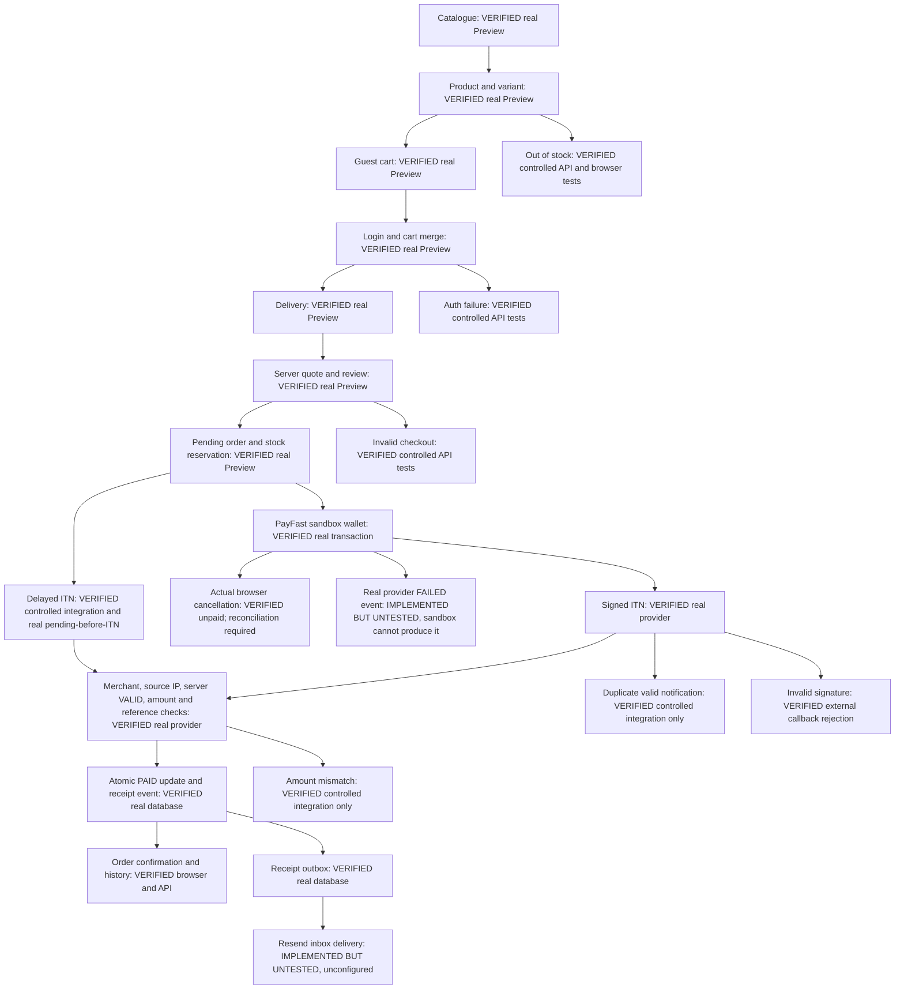

# As-built prototype process map

Evidence labels: **VERIFIED** means executed, with the evidence source stated. Controlled gateway mocks prove application behavior only; they are not real PayFast acceptance. **IMPLEMENTED BUT UNTESTED** identifies an implemented branch not exercised with the actual external service. **NOT IMPLEMENTED** identifies absent functionality.



```mermaid
sequenceDiagram
  participant UI as Customer frontend
  participant API as Commerce API
  participant DB as Preview PostgreSQL
  participant PF as PayFast sandbox
  UI->>API: Product, cart, authentication, quote
  API->>DB: Persist cart/session and read authoritative prices
  UI->>API: Checkout with idempotency key
  API->>DB: Transaction: lock stock, reserve, snapshot pending order/payment
  API-->>UI: Pending order reference
  UI->>API: Initiate payment
  API-->>UI: Signed hosted sandbox form
  UI->>PF: POST checkout form (actual sandbox)
  PF->>API: ITN on dedicated callback-only alias
  API->>API: Signature, merchant, trusted source validation
  API->>PF: Server-side notification validation
  PF-->>API: VALID
  API->>DB: Lock order/payment; validate amount/reference/status; deduplicate
  API->>DB: Commit paid status and one receipt event
  UI->>API: Poll owned order; browser redirect is not payment proof
  API-->>UI: Confirmed status and provider reference
  Note over API,DB: Every step above VERIFIED with real Preview/payment evidence
  Note over DB: Receipt delivery adapter exists; real email IMPLEMENTED BUT UNTESTED
```

| API / exception | Persisted state / protection | Evidence and branch status |
|---|---|---|
| GET /products | Active products, integer-cent prices/variants | VERIFIED real Preview; prototype fixture RP-QA-001 |
| GET/PUT /cart | Durable guest/customer cart; stock validation | VERIFIED real UI and API; refresh/login merge |
| POST /auth/register, /auth/login, /auth/logout | Salted password hash, hashed opaque session, Secure/HttpOnly cookie | VERIFIED real Preview and automated tests |
| Authentication failure | 401; no authenticated order mutation | VERIFIED controlled integration tests |
| Admin routes | Customer403, anonymous401; operator-provisioned admin only | VERIFIED real role-boundary and admin checks |
| POST /quote | Server price/discount/shipping totals | VERIFIED real R100 quote and controlled totals tests |
| POST /checkout | PENDING order/payment, stock reservation, immutable snapshot | VERIFIED real Preview; repeated key preserves order/reservation |
| Invalid checkout/out of stock | Error and transaction rollback; no partial order | VERIFIED controlled API/browser tests |
| POST /orders/:id/pay | Sandbox-only signed form; expiry and state guards | VERIFIED real PayFast accepted checkout |
| POST /payfast/notify COMPLETE | Verified signature/merchant/source/server; exact amount/reference; PAID + receipt event atomically | VERIFIED actual PayFast transaction and database |
| Invalid/tampered ITN | 400; no order/payment mutation | VERIFIED real callback BAD_SIGNATURE + controlled tests |
| Amount mismatch / unknown reference / unsupported status | Reject before state transition | VERIFIED controlled integration tests; not claimed as real sandbox ITNs |
| Browser return/cancel | Cannot mark paid or release ambiguous reservation | VERIFIED real gateway cancellation; pending, no receipt |
| FAILED notification | Unpaid order; failed-payment notification job | VERIFIED controlled tests; real provider scenario IMPLEMENTED BUT UNTESTED (sandbox limitation) |
| Duplicate valid notification | Unique event; no duplicate receipt/stock/order effect | VERIFIED controlled tests; real provider replay IMPLEMENTED BUT UNTESTED (provider sends once) |
| Delayed notification | Order remains pending until verified ITN | VERIFIED real pending/paid snapshots + controlled transition tests |
| GET /orders and /orders/:id | Owner-only history/detail | VERIFIED real API/browser and ownership tests |
| Notification job / provider unavailable | Durable deduplicated pending receipt; retryable adapter | VERIFIED real pending outbox and mocked retry tests |
| Actual app email inbox | Requires Resend credential and verified sender | IMPLEMENTED BUT UNTESTED; post-prototype backlog |
| Password recovery/MFA, automatic reconciliation, gateway refund execution | No complete implementation | NOT IMPLEMENTED; outside closure scope |

No diagram node implies production or commercial readiness. Production deployment was preserved.
